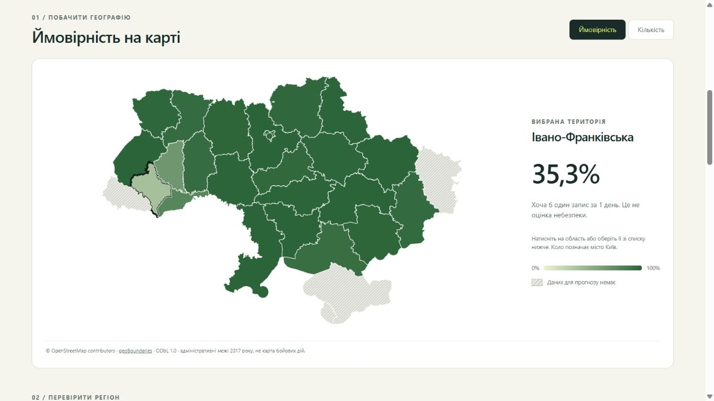

# Alert Atlas — probabilities, regional map and Telegram bot

Reproducible Python research project for KSE AI Agentic School Stage 2. It now estimates **the probability of at least one region-assigned record in a volunteer alert archive over 1, 3 or 7 local days**, alongside point count forecasts, an interactive map and a reply-only Telegram bot.

**These are probabilities of archive records, not of official alerts or danger.** Actual alert completeness is unverified. Use official notifications. Twenty-three territories are supported (22 oblasts and Kyiv City); Luhansk/Zakarpattia are stale, Crimea/Sevastopol absent. Four unavailable forecasts remain missing, never zero. [Coverage](docs/COVERAGE.md) · [Data audit](docs/SOURCES.md).

## Current delivery status

The complete version is synchronized to the owner's original repository at `C:/Ivan/python/Analysis-of-air-raid-alerts-in-Ukraine`. The full README runner passed there with 32 tests and byte-identical probability results. The private [Site](https://ivan-alert-atlas-2026.mapledrum8.chatgpt.site) now contains this probability/map version; its audience remains owner-only. GitHub changes are still local and must be committed/pushed. See [delivery status](docs/V3_STATUS.md).

The bot is not registered or running: the owner requested ready code/instructions and has no BotFather token yet. Offline tests and dry-run work; live Telegram delivery is unverified. [Bot setup](docs/TELEGRAM_BOT.md).



## Reproduce

Tested Python 3.12.14 on Windows. Dependencies are pinned; no additional dependency was needed for probabilities, map rendering or Telegram HTTPS. Initial installation needs internet; the pipeline uses included versioned data and geometry offline afterwards.

From the project root in PowerShell:

```powershell
./tools/run.ps1 -Python python
```

Use `-Python "C:/path/to/python.exe"` if the system alias is unavailable. The runner creates `.venv`, installs `requirements.txt`, runs Python tests, reproduces the two earlier count experiments, trains/evaluates period probabilities and exports the site. Each step's exit code is checked. Equivalent explicit commands:

```powershell
python -m venv .venv
./.venv/Scripts/python.exe -m pip install -r requirements.txt
./.venv/Scripts/python.exe -m pytest -q
./.venv/Scripts/python.exe -m alerts_forecast.pipeline
./.venv/Scripts/python.exe -m alerts_forecast.improve
./.venv/Scripts/python.exe -m alerts_forecast.periods
./.venv/Scripts/python.exe tools/build_dashboard.py
```

On Linux/macOS use `python3` and `.venv/bin/python`; these platforms were not executed. Run from the project root; a package installation is unnecessary.

## Website and periods

Open `site/index.html` in your own browser, or serve only the public website directory:

```powershell
./.venv/Scripts/python.exe -m http.server 8765 --bind 127.0.0.1 --directory site
```

Then visit `http://127.0.0.1:8765` and stop with Ctrl+C. The new UI supports probability/count map modes, region clicks/search/sorting, a city-of-Kyiv marker, period selection, per-region history, Brier/log-loss comparisons, reliability bins and CSV download. It needs no CDN or JavaScript packages. All values come from generated `site/data.js` / `data.json`, not manual examples. Node is optional, only for additional UI logic checks:

```powershell
node --check site/app.js
node tests/check_dashboard.mjs
```

Those logic checks use a minimal DOM fixture. Separately, the authenticated hosted desktop UI was checked: all three period controls, probability/count mode, map-region selection, missing-data states, search, evaluation-period switching and calibration worked; the browser console had no errors. The map was visually inspected. Mobile layout was not checked in this iteration. Full evidence is in [dashboard checks](docs/DASHBOARD.md) and `docs/V3_VERIFICATION.json`.

The forecast origin is frozen at **2026-10-16 00:00 Europe/Kyiv**. Periods end October 16, 18 or 22 inclusive. The 7-day percentage refers to at least one record over the entire week, not an average daily probability. Future dates cannot be chosen arbitrarily: new origins require fresh snapshots and a new prediction run. This is not a live service.

## Data and availability

Archive commit `22d0443d1d1cdf6a0a413c6d15c3078b5ed26127`, October 15, 2026; latest raw start October 15 03:28:42 UTC; latest mature target October 13. Included: 184 immutable snapshots, April 15–October 15, compacted into 485,300 regional daily queries. [Raw URLs/hashes](data/snapshot_manifest.json), [checksum](data/vintage_counts.sha256), [source MIT notice](data/SOURCE_LICENSE).

Daily target: distinct `(region, started_at)` keys falling on local date d in the first archive snapshot committed at/after local midnight d+2 and before d+3. The period count sums those fixed daily labels. Its binary event is whether that sum exceeds zero. No oblast/district/hromada rows from the incompatible official source are added.

Eligibility assumption: Git commit time + six hours must precede forecast origin. Actual first-publication time cannot independently be proved. Every feature uses an eligible historical snapshot. Training requires the entire target window's last label to be available before fitting. Missing/gapped windows fail or are excluded, not zero-filled. A seven-day forecast never uses observations from future days within its window.

Features: region, target-start weekday, lags 2/3/7, past means7/28, medians7/14, weighted mean, trend, standard deviation, and presence rates7/28. All historical windows start at d-2 because yesterday was unfinished at the previous archive update. Learned scaling/encoding are fitted on training rows only.

Map source: geoBoundaries gbOpen UKR ADM1, 27 units, administrative boundaries represented in 2017, underlying OpenStreetMap/Wambacher, ODbL 1.0. [Geometry metadata/hash](data/geometry_source.json), [separate geometry license](data/GEOMETRY_LICENSE.md). This is not a map of combat lines/current control. Each ISO code joins to exactly one registry territory.

## Probability evaluation

Candidate: separately fitted pooled logistic regression for each horizon, C=0.1, no class weighting. Baseline: smoothed proportion of any-record windows in the same past 28 dates. A cumulative-maximum postprocessing, applied before validation and inference to both candidates, enforces nested probabilities across 1/3/7 days. No independence between days is assumed and probabilities are not manufactured from count predictions.

Common validation origins: June 15–July 6, July 15–August 5, August 15–September 6. Each seven-day target ends by the corresponding previous count fold's July 12/August 11/September 12 boundary. There are 67 origins per region per horizon, 1,541 observations each. Overlapping multi-day windows are dependent. Select one model family using average macro Brier with equal region/horizon weight; tie chooses baseline. Selection is written before final forecasts. The already exposed original test is not used for this choice; no fresh independent test is available.

| Horizon | Logistic Brier | Baseline Brier | Logistic log loss |
| --- | ---: | ---: | ---: |
| 1 day | 0.075362 | **0.074905** | 0.243597 |
| 3 days | **0.057914** | 0.057955 | 0.173208 |
| 7 days | **0.047803** | 0.051990 | 0.146575 |

Logistic wins averaged over horizons, but the one-day baseline is slightly better. The dashboard shows this directly. Brier is mean squared probability error against the binary event; lower is better. Log loss also penalizes confident errors. The reliability table compares mean predictions with observed frequencies; it does not establish perfect calibration. There is no accuracy guarantee or claim that high archive probability means official danger. [Detailed method, exact folds and limitations](docs/PROBABILITY_AND_PERIODS.md).

The evaluation selector also displays the latest already-exposed period, with mature target windows ending by October 13. It is scored only after selection: 28/26/22 origins per region for 1/3/7 days, respectively. Logistic/baseline Brier is 0.043745/0.046268 (1 day), 0.028379/0.029572 (3 days), 0.015916/0.012562 (7 days). The seven-day baseline is better there. This does not change the validation-selected family and is not a new independent test. A total of 184 unfinished diagnostic outcomes remain missing; they are never interpreted as zero events.

The source was rechecked after midnight on October 16 and still matched the pinned October 15 commit: [freshness evidence](docs/FRESHNESS_RECHECK.json). CSV probabilities are stored on the 0–1 scale; the site/bot display 100 times that value as a percentage.

Count forecasts retain the previously selected 50/50 blend of MAE-trained 7-leaf histogram boosting and mean7, refitted for each period-average count and scaled by horizon. Counts are point forecasts, not a guaranteed conditional mean. Their per-period/per-region metrics are also exported. Original count results remain in `results/` and `results/improved/`, with historical descriptions [v1](docs/BASELINE_V1.md) and [v2](docs/COUNT_V2.md). The original 2.8% validation count-MAE improvement is a different experiment and must not be described as probability accuracy.

## Telegram bot

No token is needed for an offline check:

```powershell
./.venv/Scripts/python.exe -m alerts_forecast.telegram_bot --dry-run "/forecast Київ 3"
```

For live use, create a bot through official BotFather, then `./tools/run_bot.ps1` prompts for its token using hidden input. It passes `TELEGRAM_BOT_TOKEN` through the environment without saving it. Never put it in chat, source, command arguments or Git. Commands `/regions`, `/forecast Київ 1`, `/forecast Київська 3`, `/forecast Харківська 7` and inline period buttons use the exact same generated data as the site.

The bot only replies to incoming private requests; it sends no unsolicited broadcasts or live alert notifications. The Python process must stay running; the static Site does not run it. Live delivery and round-the-clock hosting are not completed. [Full setup and actual verification](docs/TELEGRAM_BOT.md).

## Outputs and reproducibility

* `alerts_forecast/periods.py`: window labels, binary probabilities, timing checks, selection, count/probability validation and forecasts.
* `results/probability/`: selection, all validation predictions, equal-region scores, reliability bins and 81 territorial/period forecast rows (69 numeric, 12 unavailable).
* `site/`: HTML/CSS/JS, generated data and CSV; same source feeds the bot.
* `alerts_forecast/telegram_bot.py`, `tools/run_bot.ps1`: token-safe, reply-only Telegram implementation.
* `data/ukraine_adm1.geojson`: pinned map geometry, no runtime tile or map API.
* `docs/EXPERIMENT_LOG.md`: real iterations; it is not the conversation export.

To reproduce probability outputs into another directory:

```powershell
./.venv/Scripts/python.exe -m alerts_forecast.periods --output .tmp/probability-reproduction
```

No original final test can become unseen again. Future confirmation needs a predeclared fresh period and fresh data; the Git commit + six-hour availability assumption remains a limitation. Submission still requires GitHub code, an authentic full conversation export and a personally reviewed ~100-word reflection. Refresh the chat export after the final response.

Local submission materials are in the owner's `submission/` directory, deliberately ignored by Git. They contain the reflection, authentic chat export and refresh instructions; the public project ZIP omits that private directory. Refresh the chat export after the final assistant reply.
