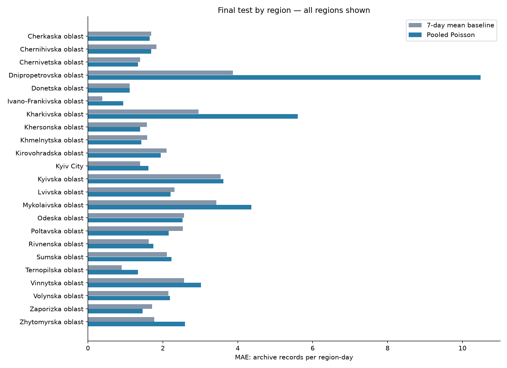
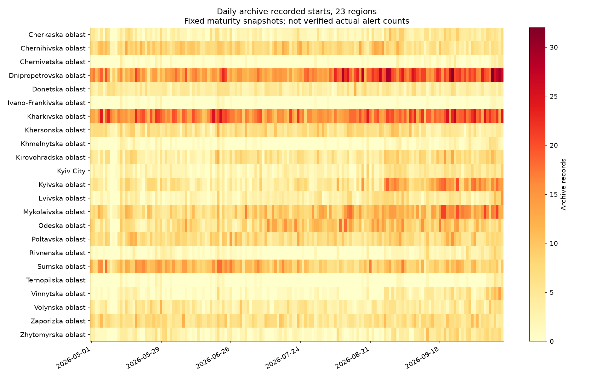
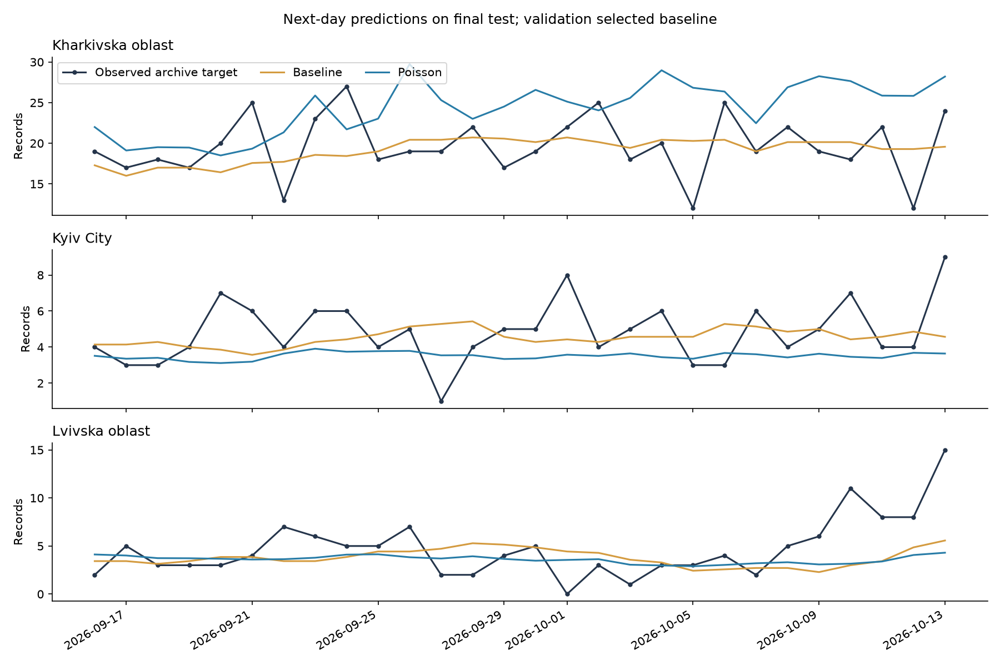

> Archived first experiment. See the root README for the current ML and dashboard.

# Next-day forecasting of Ukrainian alert archive records

A small, reproducible Python project for KSE AI Agentic School Stage 2. It predicts the next local day's count of **region-assigned records in a volunteer alert archive**, separately for 22 oblasts and Kyiv City, using a common model and a simple baseline.

**This is partial nationwide coverage, not verified counts of all actual air-raid alerts.** Luhansk and Zakarpattia have stale archive coverage; Crimea and Sevastopol are absent. Their forecasts are missing. The original official/volunteer splice was rejected for modelling because territorial levels and event extraction differ. See [source audit and exact target](../docs/SOURCES.md) and [every region's coverage](../docs/COVERAGE.md).

Research use only. Predictions are expected archive counts, not probabilities of danger, incident locations or timings. They must never replace official alert notifications. A plausible application is comparing regional archive activity and planning analytical workloads; operational safety value is not established.

## Reproduce

Tested with Python 3.12.14 on Windows. Use a regular Python 3.12 installation. No API token is needed. Internet is required only for initial dependency installation; data and normal evaluation are offline.

From the repository root on Windows PowerShell:

```powershell
./tools/run.ps1 -Python python
```

If `python` is a broken Windows alias, supply the full path of a working Python executable with `-Python`. The script creates `.venv`, installs pinned dependencies, runs tests and executes the full pipeline. It keeps temporary installation files inside the repository's ignored `.tmp` directory. No activation is required.

Equivalent commands on Windows:

```powershell
python -m venv .venv
./.venv/Scripts/python.exe -m pip install -r requirements.txt
./.venv/Scripts/python.exe -m pytest -q
./.venv/Scripts/python.exe -m alerts_forecast.pipeline
```

On Linux/macOS, use `python3 -m venv .venv` and `.venv/bin/python` for the remaining commands. Those platforms were not executed here. Exact packages are pinned in [requirements.txt](../requirements.txt); numerical results may differ slightly across platforms.

Outputs go to `results/`. To preserve the shipped results during a fresh run:

```powershell
./.venv/Scripts/python.exe -m alerts_forecast.pipeline --output .tmp/reproduction
```

## Data and forecast definition

The latest checked archive commit is `22d0443d1d1cdf6a0a413c6d15c3078b5ed26127` (October 15, 2026). The source's latest record starts at 03:28:42 UTC that day. We include 184 immutable historical snapshots, compacted into 485,300 region-day queries. The normal run checks the compact data checksum. The [manifest](../data/snapshot_manifest.json) records raw file hashes and immutable download URLs; [MIT attribution](../data/SOURCE_LICENSE) is retained.

Target: count unique `(region, started_at)` entries starting on local date d, as recorded by the first snapshot committed at/after midnight d+2 and before d+3. This gives a measurable source-defined outcome despite undocumented end/publication delays. It does not establish real alert completeness. Latest mature outcome: **2026-10-13**; October 14 is not mature and October 15 is partial. Unknown source coverage is never converted into zero actual alerts.

Forecast origin: midnight at the start of the target day in `Europe/Kyiv`. Horizon: one local calendar day (23/24/25 hours across daylight-saving changes). For example, the October 16 forecast uses information available before October 16 00:00. Fractional predictions are expected counts and are not rounded for evaluation.

Every input snapshot must have commit time plus a six-hour availability buffer before origin. This is an explicit publication assumption; first public availability cannot be independently proved. `model_panel.csv.gz` preserves exact feature and label snapshot times for inspection.

| Input | Why it is known at forecast origin |
| --- | --- |
| Region indicator | Fixed source geography label |
| Lags 2, 3 and 7 | Counts from an eligible historical snapshot, for days already ended |
| Mean of days d-2 through d-8 | Seven fully elapsed source-query dates, using the same eligible snapshot |
| Mean of days d-2 through d-29 | Twenty-eight elapsed source-query dates |
| Sine/cosine of target weekday | Calendar is known in advance |

Yesterday is deliberately skipped: the archive is updated before that day has finished. Future end times, threat texts, latest revisions and full-day target totals are never features. The available historical counts can still be incomplete; that is part of the archive proxy limitation.

## Evaluation and model choice

All 23 regions share the same inclusive target-date boundaries:

| Part | Dates | Days per region | Rows |
| --- | --- | ---: | ---: |
| Train | 2026-05-01–2026-07-29 | 90 | 2,070 |
| Validation | 2026-08-01–2026-09-12 | 43 | 989 |
| Final test | 2026-09-16–2026-10-13 | 28 | 644 |

The short gaps ensure training/validation labels have matured before the next simulated fit or selection deadline. Earlier archive days supply lag warm-up. All fits explicitly reject labels unavailable at fit time.

Baseline: mean of seven eligible daily counts (d-2 through d-8). Candidate: one pooled Poisson regression, with standardized numeric features and one-hot region indicators. Pooling shares information across a short regional training history while allowing region-specific intercept effects; it may miss region-specific trends and slopes. Poisson regression provides nonnegative expected counts; its distributional assumptions are not guaranteed here. Regularization alpha=0.1 was specified once; no hyperparameter search was run. Learned preprocessing is fitted on training rows only.

Fit on train, select by equal-region validation MAE, write `model_selection.json`, then refit the candidate on train+validation and evaluate the untouched final test. No settings or selection are changed using test scores. Test metrics for both candidates are reported for comparison. This is a retrospective simulation, not a claim that the choice was made live in September.

| Period | Forecast | Macro MAE | Macro RMSE | Macro bias |
| --- | --- | ---: | ---: | ---: |
| Validation | Seven-day mean | 1.869 | 2.404 | -0.104 |
| Validation | Pooled Poisson | 2.510 | 3.160 | +0.397 |
| Final test | Seven-day mean | 2.049 | 2.623 | -0.381 |
| Final test | Pooled Poisson | 2.550 | 3.172 | +0.200 |

**The baseline wins on validation and remains the final choice.** MAE is the average absolute count error. RMSE penalizes large misses more strongly. Bias is prediction minus observation: negative means underprediction. Each region receives equal weight in macro metrics; macro RMSE is the mean of regional RMSEs, not the square root of pooled MSE. MAPE is omitted because zero-count days make it undefined or unstable.

The baseline's test MAE ranges from 0.388 (Ivano-Frankivska) to 3.872 (Dnipropetrovska). A small error in a quiet region does not establish a good warning system. On October 9 in Dnipropetrovska it predicted 19.14 records versus 32 observed (absolute error 12.86). On October 13 in Lvivska it predicted 5.57 versus 15 (error 9.43). These misses illustrate why the average alone is insufficient. Full regional metrics and largest errors are shipped.







Archive activity differs greatly across regions and over time. The pooled model notably overpredicts Dnipropetrovska on the test (regional bias +10.22 records/day). The simple moving mean adapts to recent levels but misses sudden spikes. These are descriptive findings, not evidence about underlying military causes. No causal or high-accuracy claim is made.

## Files and verification

* `alerts_forecast/pipeline.py`: preparation, availability checks, models, evaluation, plots and October 16 forecast demonstration.
* `data/`: compact versioned counts, immutable snapshot manifest, checksum and source notice.
* `tests/test_pipeline.py`: temporal boundaries, DST, future-snapshot isolation, fixed target vintages, missingness, equal-region weighting and validation-only selection.
* `results/metrics_by_region.csv`, `metrics_macro.csv`: actual executed evaluation results.
* `results/coverage.csv`: all 27 registry units, exact regional endpoints and unavailable statuses.
* `results/test_predictions.csv`, `validation_predictions.csv`, `largest_errors.csv`: inspectable predictions and errors.
* `results/next_day_forecast.csv`: October 16 example, with unavailable entries for excluded territories. This is a frozen-snapshot demonstration, not a live service.
* `results/verification.json`, `model_selection.json`: dates, row counts, revision checks and selection evidence.
* `docs/EXPERIMENT_LOG.md`: actual iterations, including the rejected splice and scope correction.

Eleven focused tests and the full pipeline were executed. Runtime assertions check common test length, disjoint date ranges, available training labels and feature snapshots; normal execution also verifies the data checksum. The publication assumption remains outside what code can prove. See [execution record](../docs/EXECUTION.md) for the actual environment and repeatability check.

Optional raw provenance rebuild (large download, about 1.5 GB uncompressed across versions; no token):

```powershell
./.venv/Scripts/python.exe tools/rebuild_vintages.py --cache .vintage_cache --workers 4
./.venv/Scripts/python.exe -m alerts_forecast.pipeline
```

Every raw snapshot is checked against its recorded SHA-256 before use. This rebuild was executed to create the compact dataset; ordinary reproduction does not require it. Future data updates are a new experiment: retain this frozen evaluation, define a new holdout, and avoid tuning on the test already reported here.
