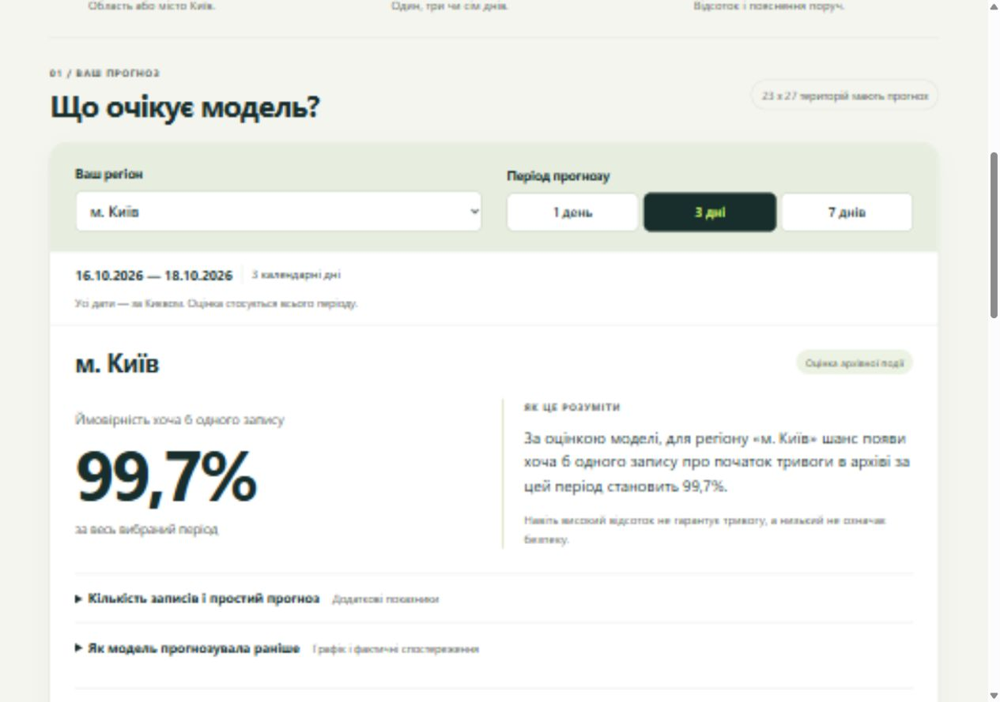

# Public dashboard

Current primary URL: https://analysis-of-air-raid-alerts-in-ukra.vercel.app/
Telegram: https://t.me/air_alert_atlas_bot

The owner deployed the static dashboard to Vercel. On October 16, 2026, the public page loaded without authentication. HTML, CSS, JavaScript, JSON and CSV returned HTTP 200 and matched the pre-review local source after line-ending normalization. The browser passed period, map/count-mode, search, missingness, evaluation/calibration and CSV-download checks, with no console errors. See [FINAL_REVIEW.md](FINAL_REVIEW.md) and [FINAL_PUBLIC_CHECK.json](FINAL_PUBLIC_CHECK.json).

## Source and deployment

`site/` contains the complete static website. `tools/build_dashboard.py` regenerates `data.js`, `data.json` and `forecasts.csv` from executed Python results; the bot reads the same JSON. There are no Node dependencies, runtime map tiles or live backend. Preserve the existing Vercel settings; deploy the contents of `site/`. Python model training and Telegram polling run separately.

The latest local revision reorganizes the page around one task: choose a region and horizon, then read one forecast with a plain-language explanation. Technical metrics and history are collapsed by default. The native region selector, map and searchable directory share the same selection. Text is larger (18 px desktop, 17 px mobile), primary forecast controls have at least 48 px height, and narrow historical charts scroll horizontally. These edits require a new Vercel deployment after Git push; no deployment of this redesign is claimed. Map/probability data and model settings are unchanged.

The modified local page was served over HTTP and checked in the browser: the Telegram button and corrected diagnostic label are present, with no console errors.

The dashboard remains a fixed October 16 research example with 23 supported forecasts per period and four unavailable territories. It has no automatic refresh, danger probabilities or live warning service. The redesign was inspected at the normal desktop viewport and a 390×844 mobile viewport; no page-wide horizontal overflow was observed, including with the research section open. The screenshot below is a local preview, not proof of a redeployed public page. See [redesign verification](READABILITY_REVIEW.json).

## Historical hosting evidence

The earlier owner-private Sites deployment is retained as a historical experiment, not the primary demo. [SITE_V3_DEPLOYMENT.json](SITE_V3_DEPLOYMENT.json) records its exact old URL/commit/deployment and must not be rewritten to pretend Vercel was published by that operation. Earlier access settings do not describe the current public Vercel deployment. The old deployment records and earlier screenshots are provenance; all current navigation uses Vercel and the supplied bot username.

## Two-event revision — October 16, 2026

The local revision adds `/threshold Київ 3` and event buttons alongside the existing `/forecast` event. The website has an explicit target selector; it updates probabilities, map, history, evaluation, AUC and the corresponding CSV. ≥3 includes exactly three on one local day, not the sum across days. The selected new-target method is smoothed frequency, chosen on validation. All counts still refer to all archive records. See [the experiment](THRESHOLD_PROBABILITY.md) and [integration verification](DUAL_TARGET_VERIFICATION.json). Both Vercel projects need the new commit; existing webhook registration remains valid. New-target live delivery is not yet verified.
